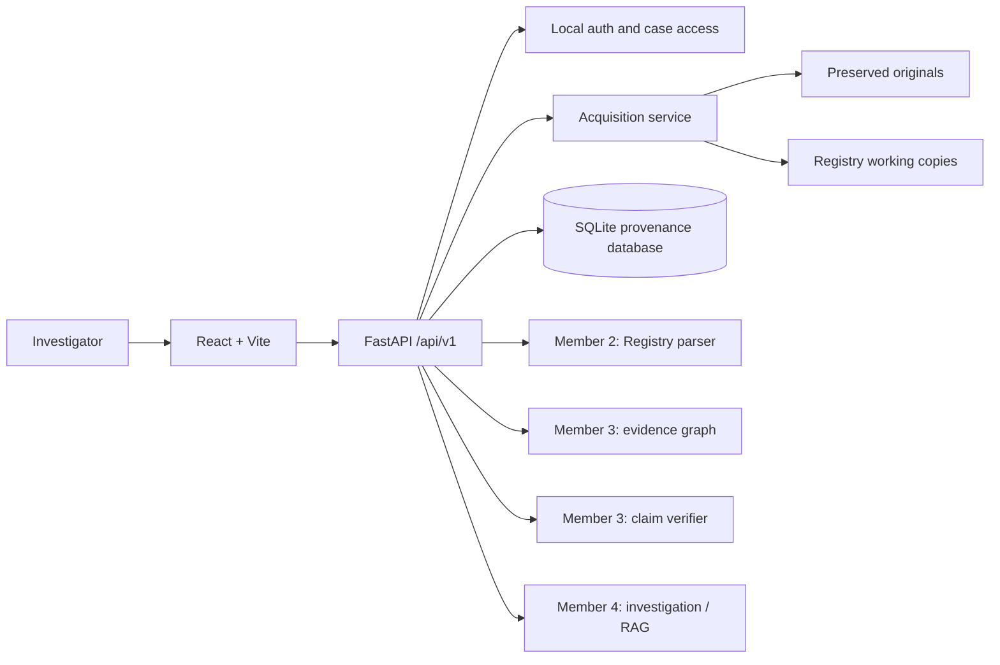

# evidenceARCH

### Local Windows Registry Evidence Acquisition & Investigation Prototype

An academic Phase 1 prototype for collecting, preserving, organizing, and tracing digital evidence through an investigation workflow.

Built with **FastAPI**, **SQLite**, **React**, and **Vite**. The core demo runs locally without paid services, external APIs, or an LLM key.


[Overview](#overview) · [Workflow](#investigation-workflow) · [Architecture](#architecture) · [Setup](#run-locally) · [Demo](#run-the-guided-demo) · [API](#api-overview) · [Team Integration](#team-integration)

---

## Overview

EVIDENCEARCH provides a local workspace for a Windows Registry investigation. It records how evidence was acquired, preserves the uploaded original, calculates a SHA-256 hash, and gives parser and investigation modules a stable place to return normalized results.

The project focuses on **evidence provenance and workflow**: an investigator should be able to trace a record or claim back to the file it came from and see whether a result is real, synthetic, or still unverified.

### Why this project exists

Digital investigations can involve multiple files, extracted artifacts, and proposed explanations. This prototype explores questions such as:

- How can an acquired file be identified and preserved throughout analysis?
- How can normalized records retain a link to their source file?
- How can a graph or investigation claim show which evidence IDs support it?
- How can demo output remain visibly separate from actual forensic findings?
- How can separate parser, graph, verifier, and investigation modules integrate through stable contracts?

## Investigation workflow

1. **Create a case** and assign it to a local investigator account.
2. **Acquire evidence.** The API records the original filename, size, timestamp, category, and SHA-256 hash.
3. **Preserve provenance.** Originals remain unchanged. Registry files receive a separate working copy for parsing; supplementary documents do not.
4. **Normalize records.** A Registry parser adapter can return records using the shared evidence schema.
5. **Explore relationships.** A graph adapter returns nodes and edges. The demo graph only illustrates synthetic file-to-record provenance.
6. **Investigate and verify.** An investigation adapter may propose claims; the verifier assigns the final status and explanation.

## Project capabilities

| Area | Current implementation |
|---|---|
| Case management | Local investigator accounts, case ownership, status updates, archive behavior |
| Evidence acquisition | File validation, SHA-256, acquisition log, metadata, duplicate handling, preserved original |
| Registry workflow | Separate working copy for `.dat`, `.hive`, `.bin`, and `.reg` evidence |
| Supplementary evidence | PDF, DOCX, text, JSON, XML, image, EVTX, and log intake; original-file open/download |
| Evidence records | Pydantic-validated common schema and source-file provenance |
| Evidence graph | Cytoscape integration point and clearly labeled synthetic demo provenance links |
| Investigation | Question submission, claims, evidence references, uncertainty, gaps, and recommendations |
| Verification | `SUPPORTED`, `CONTRADICTED`, or `NOT_ESTABLISHED` from the verifier adapter |
| Interface | React dashboard with persisted light and dark themes |

## Forensic integrity boundary

EVIDENCEARCH is a **workflow prototype**, not a production forensic suite. The included adapters are deterministic demos:

- The demo parser does not parse Registry contents. A `regf` header check only recognizes a header; it does not prove a hive is valid or parseable.
- Demo graph links are generated only for records labeled `DEMO_ONLY`. They illustrate source-file provenance and are not forensic relationships.
- The demo investigator does not use an LLM, retrieve documents, or extract PDF, DOCX, or image content. It receives supplementary-file metadata only.
- The unconfigured verifier returns `NOT_ESTABLISHED`. An investigation model does not set final verification status.
- The files in [`demo/`](demo/) are synthetic fixtures, not evidence collected from a real computer.

These boundaries are displayed in the app so sample data cannot be mistaken for actual Registry findings.

## Architecture



### Engineering highlights

- **Evidence integrity:** streaming SHA-256 calculation, size limits, source-file metadata, and separate Registry working copies.
- **Traceable records:** each normalized record is linked to its case and source evidence file.
- **Replaceable modules:** parser, graph, investigation, and verification adapters are defined behind Python protocols.
- **Claim verification boundary:** only the verifier assigns a final verification status.
- **Local-first setup:** SQLite and local file storage; no paid cloud, vector database, or hosted model is required.

## Technology stack

| Layer | Technology |
|---|---|
| Backend | Python 3.11+, FastAPI, Pydantic |
| Database | SQLite |
| Authentication | Argon2 password hashing, JWT in an HttpOnly cookie |
| Frontend | React, Vite, Cytoscape.js, Lucide icons |
| Tests | pytest, Vitest |
| API documentation | FastAPI OpenAPI and Swagger UI |

## Project structure

```text
EVIDENCEARCH/
├── backend/
│   ├── app/
│   │   ├── api/             # Versioned routes and authentication
│   │   ├── core/            # Settings and security
│   │   ├── db/              # SQLite schema and initialization
│   │   ├── integrations/    # Parser, graph, investigation, verifier adapters
│   │   ├── schemas/         # Pydantic request/response contracts
│   │   └── services/        # Acquisition, hashing, persistence
│   ├── tests/
│   └── requirements.txt
├── demo/                    # Explicitly synthetic evidence fixtures
├── docs/                    # Architecture, schema, API, integration contracts
├── frontend/
│   └── src/                 # React app, auth screen, API client, styles
└── README.md
```

## Run locally

### Prerequisites

- Python 3.11 or newer
- Node.js 20 or newer and npm

### Start the backend

In PowerShell, from the repository root:

```powershell
cd backend
py -3 -m venv .venv
.\.venv\Scripts\Activate.ps1
python -m pip install -r requirements.txt
python -m uvicorn app.main:app --reload
```

### Start the frontend

Open a second PowerShell window at the repository root:

```powershell
cd frontend
npm install
npm run dev
```

Open the application at <http://127.0.0.1:5173> and create or sign in to a local investigator account.

| Service | URL |
|---|---|
| Web application | <http://127.0.0.1:5173> |
| Swagger UI | <http://127.0.0.1:8000/docs> |
| OpenAPI JSON | <http://127.0.0.1:8000/openapi.json> |
| Health check | <http://127.0.0.1:8000/api/v1/health> |

SQLite tables are initialized on backend startup. Database and evidence paths are relative to the backend working directory by default.

### Configuration

Copy `backend/.env.example` to `backend/.env` to override local defaults. Supported settings use the `EVIDENCEARCH_` prefix:

| Variable | Purpose | Default |
|---|---|---|
| `EVIDENCEARCH_DATABASE_PATH` | SQLite database location | `./data/evidencearch.sqlite3` |
| `EVIDENCEARCH_STORAGE_PATH` | Evidence storage directory | `./data/evidence` |
| `EVIDENCEARCH_DEMO_MODE` | Enables controlled demo fixtures | `true` |
| `EVIDENCEARCH_MAX_UPLOAD_BYTES` | Maximum upload size | `50 MiB` |
| `EVIDENCEARCH_JWT_SECRET` | Session signing secret | Random per process if unset |
| `EVIDENCEARCH_JWT_EXPIRE_MINUTES` | Session lifetime | `60` |
| `EVIDENCEARCH_COOKIE_SECURE` | Secure-cookie setting for HTTPS | `false` for local HTTP |
| `EVIDENCEARCH_CORS_ORIGINS` | Allowed frontend origins | Local Vite origins |

If `EVIDENCEARCH_JWT_SECRET` is unset, restarting the backend invalidates existing sessions. Set a local secret in `.env` if you want sessions to survive backend restarts. Do not commit `.env`.

## Run the guided demo

1. Sign in to the local app and create a case.
2. Open **Evidence intake** and select **Create synthetic demo fixture**.
3. The case receives three synthetic files: a header-only `.dat`, a small `.reg` export, and supplementary `.txt` context. Each appears with a demo label and SHA-256.
4. Select **Open original** for the `.reg` or `.txt` file. The `.dat` file downloads as binary; the fixture is not a valid Registry hive.
5. Select **Parse copy** on a Registry fixture. The demo adapter returns a synthetic record without parsing the bytes.
6. Review **Evidence records** and **Evidence graph**. The graph shows synthetic source-file-to-record links only.
7. Submit a question in **AI investigation**. Review the demo claim, evidence IDs, gap, recommendations, and `NOT_ESTABLISHED` status.

For a manual hash comparison, download or open a sample and run:

```powershell
Get-FileHash .\demo\synthetic_registry_export.reg -Algorithm SHA256
```

The result should match the SHA-256 shown in the evidence table.

## API overview

All endpoints use the `/api/v1` prefix. Signup and login are public; case and evidence operations require the HttpOnly session cookie.

| Group | Endpoints |
|---|---|
| Health | `GET /health` |
| Authentication | `POST /auth/signup`, `POST /auth/login`, `POST /auth/logout`, `GET /auth/me` |
| Cases | `POST /cases`, `GET /cases`, `GET /cases/{case_id}`, `PATCH /cases/{case_id}` |
| Evidence | `POST /cases/{case_id}/evidence/upload`, `GET /cases/{case_id}/evidence`, `GET /evidence/{evidence_id}`, `GET /evidence/{evidence_id}/open` |
| Acquisition | `GET /cases/{case_id}/acquisition-log`, `GET /evidence/{evidence_id}/acquisition` |
| Parser and graph | `POST /cases/{case_id}/parse`, `GET /cases/{case_id}/records`, `GET /cases/{case_id}/graph` |
| Investigation | `POST /cases/{case_id}/investigate`, `GET /cases/{case_id}/investigations` |
| Verification | `POST /cases/{case_id}/verify`, `GET /cases/{case_id}/verifications` |

See [`docs/api-contract.md`](docs/api-contract.md) for request/response details and error behavior.

## Team integration

| Member | Module | Integration contract |
|---|---|---|
| 2 | Windows Registry parser | Implement `RegistryParserAdapter.parse(...)`; return common-schema records with `source_evidence_id`. Parsing receives the working copy. |
| 3 | Evidence graph | Implement `EvidenceGraphAdapter.get_graph(...)`; return identified nodes and edges with supporting IDs and explanations. |
| 3 | Claim verification | Implement `VerificationAdapter.verify(...)`; resolve evidence references and assign a supported final status. |
| 4 | Investigation / RAG | Implement `RAGInvestigationAdapter.investigate(...)`; propose claims, uncertainty, gaps, and recommendations. The verifier assigns claim status. |

Adapter wiring is documented in [`docs/integration-guide.md`](docs/integration-guide.md) and [`docs/INTEGRATION.md`](docs/INTEGRATION.md). Shared schemas are in [`docs/evidence-schema.md`](docs/evidence-schema.md).

## Tests

From the repository root, run:

```powershell
cd backend
python -m pytest -q
cd ..\frontend
npm test
npm run build
```

Backend tests cover authentication, case ownership, uploads, signatures, SHA-256, provenance, original-file viewing, working-copy behavior, mock adapters, and API errors. Frontend tests cover API behavior; the production build checks that the React application compiles.

## Troubleshooting

| Symptom | Check |
|---|---|
| Signup or API shows `Not Found` | Restart FastAPI from the `backend` directory, then reload the frontend. |
| Port `8000` or `5173` is busy | Stop the process using that port or configure a different local port. |
| PowerShell blocks venv activation | Run `Set-ExecutionPolicy -Scope Process Bypass` in that terminal, or use `.venv\Scripts\python.exe` directly. |
| Upload returns `415` | Confirm the extension and content signature are supported. A `regf` header alone does not prove a hive is valid. |
| PDF or DOCX has no extracted text | Supplementary files are stored as evidence; content extraction is not part of the demo. Use **Open original** to view or download supported files. |
| Session expires after a backend restart | Set `EVIDENCEARCH_JWT_SECRET` in local `.env`, or sign in again. |
| Graph is empty | The demo graph only draws links for parsed `DEMO_ONLY` records. Parse a synthetic Registry fixture; real evidence needs Member 3's graph adapter. |
| Claims show `NOT_ESTABLISHED` | Expected until an independent verification adapter is integrated. |

## Git workflow

Create a feature branch and review changes before staging:

```powershell
git checkout -b feature/member-1-backend-frontend
git status --short
git add README.md .gitignore backend frontend docs demo
git status --short
```

Do not stage `.env`, virtual environments, `node_modules`, SQLite runtime databases, uploaded evidence, working copies, logs, or build output. A suitable commit message is `feat: implement EvidenceARCH investigation workflow`.

## Repository hygiene

Commit source code, tests, documentation, demo fixtures, and dependency lockfiles. Keep `.env`, virtual environments, `node_modules`, SQLite databases, acquired evidence, working copies, logs, and build artifacts out of version control. These runtime files are covered by `.gitignore`.

This repository does not currently declare an open-source license. Choose and add a license before granting reuse rights.
